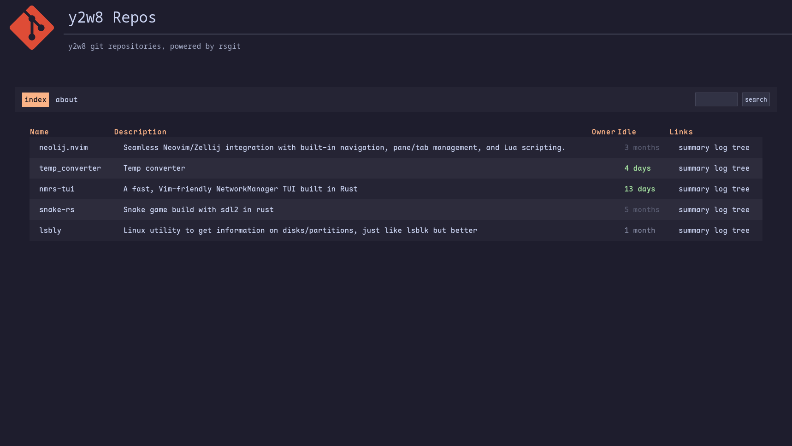

# git-rs

A fast, minimal web interface for self-hosted Git repositories, inspired by `cgit` and written in Rust using Actix Web, `gix` (gitoxide), and Askama templates.


[*Demo*](https://git.y2w8.online)

## Features

- Browse repositories, branches, tags, commit logs, and file trees
- Unified diffs with diffstat bars and raw `.patch` export (`git am` compatible)
- Download `.tar.gz` snapshots of any branch, tag, or commit
- Read-only HTTP smart protocol support (`git clone` / `git pull`)
- Automatic filesystem watcher (`notify`) that picks up new or removed repositories in `/srv/git` without restarting the server
- Markdown rendering for repository `README` files
- Static assets and templates compiled directly into a single binary

More screenshots are available in [`docs/screenshots/`](docs/screenshots/).

## Usage

By default, `git-rs` reads bare repositories from `/srv/git` and listens on `127.0.0.1:80`:

```sh
git-rs --url 0.0.0.0 --port 80 --repos-dir /srv/git
```

### Options

| Flag | Default | Description |
| :--- | :--- | :--- |
| `-u, --url <URL>` | `127.0.0.1` | Bind address |
| `-p, --port <PORT>` | `80` | Port to listen on |
| `-r, --repos-dir <DIR>` | `/srv/git` | Directory containing bare Git repositories |

## Repository Metadata

For each bare repository in `/srv/git/<repo>`:

- **Description:** Write a plain-text description to `/srv/git/<repo>/description`
- **Owner:** Set `gitweb.owner` in the repository config:
  ```sh
  git -C /srv/git/<repo> config gitweb.owner "your-name"
  ```

## Installation

Install from crates.io or directly from the repository:

```sh
# From crates.io
cargo install git-rs

# Or from a local checkout
cargo install --path .
```

To install and start the `systemd` service:

```sh
sudo $(which git-rs) --install-service --url 0.0.0.0 --port 80 --repos-dir /srv/git
sudo systemctl daemon-reload
sudo systemctl enable --now git-rs
```

## License

Licensed under the [GPL-3.0](LICENSE) license.
